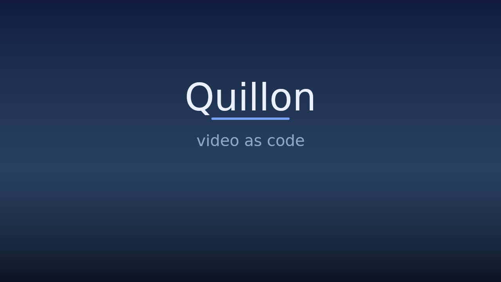
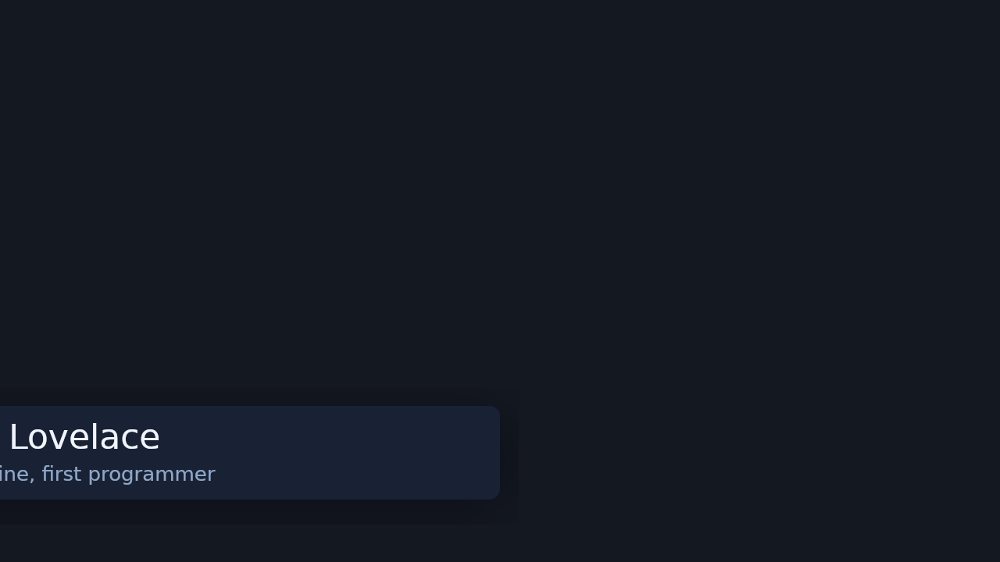
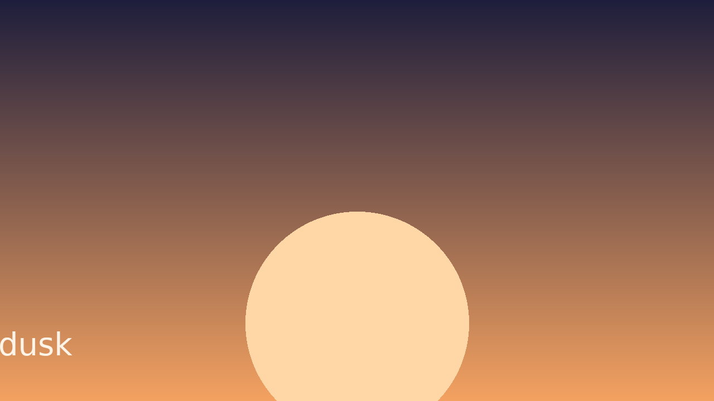
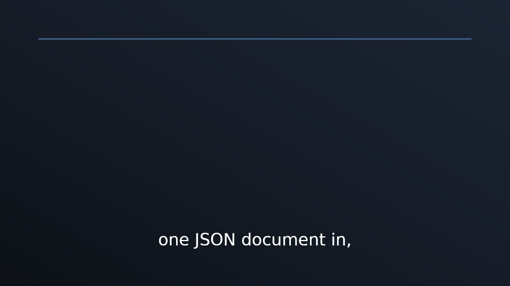
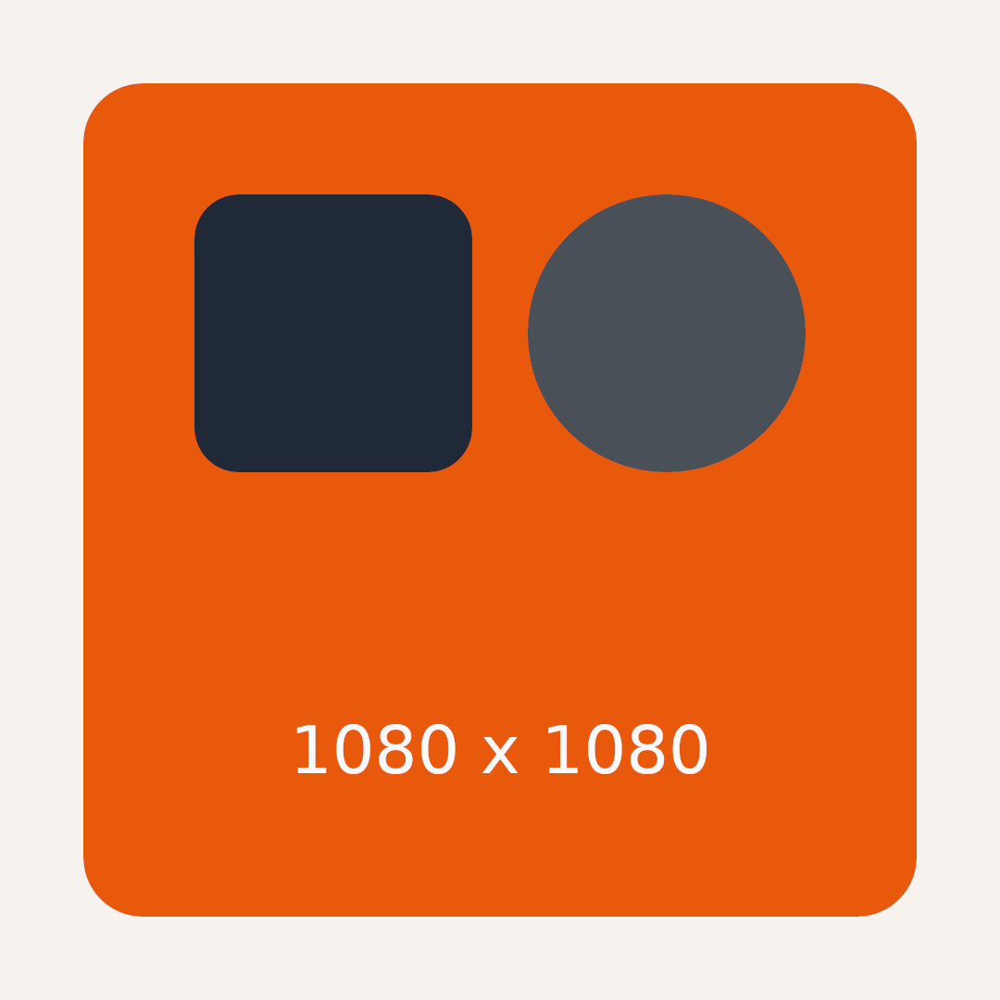

# Template gallery

Every image below is rendered by `cargo xtask gallery` from the
committed document in `templates/` — the same `Renderer` the real
render path uses, one mid-animation frame each. Nothing here is
hand-drawn; regenerate them all with:

```
cargo xtask gallery
```

## Title card

Text on a gradient with an `out_back` entrance — the "hello world" of
motion graphics.



Source: [`templates/title-card.json`](../templates/title-card.json)

## Lower third

A broadcast-style bar sliding in from the left (`translate_x` with
`out_cubic`), name and role staggering behind it, with a soft shadow.



Source: [`templates/lower-third.json`](../templates/lower-third.json)

## Slideshow

Full-frame images with a crossfade transition between scenes — the
media lane (images are generative test art, committed in
`templates/assets/`).



Source: [`templates/slideshow.json`](../templates/slideshow.json)

## Caption burn-in

A caption track (three cues) rendered over the canvas at the bottom
margin — the caption lane. This exact frame shows the second cue.



Source: [`templates/captions.json`](../templates/captions.json)

## Social square

A 1080×1080 canvas for social platforms: staggered shape entrances
(opacity + `out_back` translate), rounded and circular rects.



Source: [`templates/social-square.json`](../templates/social-square.json)

## Render any of them to video

```
cargo run -p quillon-cli --bin quillon -- render templates/title-card.json -o title.mp4
```

Or a mail-merge batch over your own data (see
[`docs/guide.md`](guide.md)):

```
quillon render templates/title-card.json --data names.csv -o 'out/{{name}}.mp4'
```
