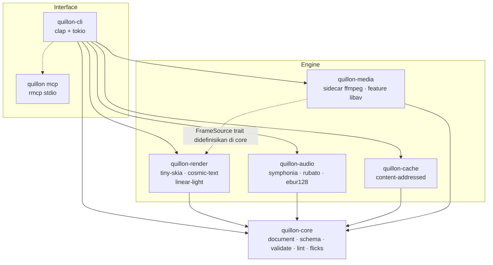

# myquillonplan.md — Quillon: Video as Code

**Rencana arsitektur & pembangunan** · Status: final · Tanggal: 2026-11-17 · Pemilik: AlbiFahriiza
Repo: https://github.com/AlbiFahriiza/quillon · Lisensi: MIT OR Apache-2.0

Dasar dokumen ini: 20 dokumen riset di `research/` (A–T), disusun selama jendela riset 2 jam penuh. Setiap klaim crate diverifikasi langsung ke crates.io API pada 2026-11-17 (bukan dari memori model); setiap klaim pesaing bersumber dari halaman resmi/paper yang dicantumkan di tiap dokumen riset.

---

## 1. Ringkasan eksekutif

Quillon adalah video engine open-source berbasis Rust dengan konsep **Video as Code**: membuat video dari nol lewat kode, dan mengedit video yang sudah ada secara programatik. Satu binary, tanpa browser, tanpa Node, tanpa lisensi per-render.

Quillon adalah **tools AI** dalam arti harfiah: permukaan interaksi utamanya dirancang untuk AI agent (MCP server + JSON Schema + loop termurah-dulu), sehingga agent bisa membuat dan mengedit video dengan hasil tervalidasi, bukan menebak. Developer Rust tetap mendapat library crates dan builder API.

**Satu kalimat posisi:** *Quillon — Video as Code. Buat dari nol dengan kode. Edit video yang ada secara programatik. Satu binary Rust, tanpa browser, tanpa lisensi per-render, dirancang untuk agent dari hari pertama.*

**Mengapa ini berguna (temuan riset, bukan opini):**

- Remotion (incumbent, 73.8k bintang) butuh Chrome headless, Node, dan lisensi berbayar untuk perusahaan >3 orang ($0.01/render atau $25/kursi/bulan); render dilaporkan 2–4x durasi video pada 8 vCPU + GPU (research/A §1).
- Pembeli video-as-code hari ini cuma developer (setup template $3k–6k); pembeli AI-video cuma marketer. Dua jalur ini saling eksklusif (research/F §1). Quillon menyatukan keduanya: dev dapat Rust + determinisme; non-dev dapat agent yang menghasilkan dokumen JSON tervalidasi.
- Pendekatan dokumen-dulu terbukti: Clipkit melaporkan 100% video agent valid vs 87% Remotion, dengan ~1.6x lebih hemat token, karena dokumen tidak valid tertangkap validator sebelum render (research/C §2).
- Celah yang belum diisi siapa pun (research/A §9): engine yang benar-benar terbuka (MIT/Apache) + GPU/CPU native + zero-browser + zero-ffmpeg-di-PATH + **editing footage yang sudah ada sebagai warga kelas satu** + **repreduksibilitas sebagai kontrak**.

---

## 2. Masalah & peluang (intisari riset)

| # | Temuan | Sumber riset |
|---|--------|--------------|
| 1 | Render berbasis screenshot browser lambat dan rapuh (crash headless Chrome menggantung render) | research/A §1, §8 |
| 2 | Lisensi Remotion menghalangi adopsi korporat; semua halaman perbandingan pesaing memakai ini | research/A §1, §11 |
| 3 | Format "dokumen murni" (Kineto) membuat render deterministik lintas platform, tapi cuma 2D CPU dan tanpa editing footage | research/D §2 |
| 4 | fframes membuktikan Rust+Skia jauh lebih cepat (31x pada satu sintetik; jujur dicatat sebagai best-case), tapi code-DSL saja tanpa jalur data untuk agent | research/D §4 |
| 5 | vidformer (ACM MM'26) membuktikan pola *declarative spec → executor optimasi → serving JIT*: full render 2–3x lebih cepat, time-to-playback 0.25–0.5 detik | research/D §1 |
| 6 | Loop agent termurah-dulu (validasi ~20 token → pratinjau ~390 token/frame → render) adalah pola ekonomis yang terukur | research/C §1, §3 |
| 7 | Ekosistem Rust 2026: binding libav aktif (ffmpeg-next 9.1.0), compositor CPU matang (tiny-skia), teks matang (cosmic-text), audio murni-Rust lengkap (symphonia+rubato), MCP SDK resmi (rmcp 3.10.0) — semua terverifikasi | research/B, K |
| 8 | Tidak ada muxer MP4 murni-Rust yang terawat (crate `mp4` stagnan 3 tahun) → muxing harus lewat libav/ffmpeg | research/B §2 |
| 9 | OTIO tidak punya binding Rust matang (placeholder saja) → subset JSON OTIO harus diparse sendiri | research/D §5 |
| 10 | Error validasi `oneOf` dari jsonschema tidak ramah agent (terukur empiris) → Quillon wajib mapping error sendiri dengan JSON-pointer | research/J |

---

## 3. Prinsip desain (tidak bisa ditawar)

- **P1 — Dokumen dulu, kode kemudian.** Format pertukaran adalah dokumen JSON tervalidasi schema (agent-safe, bisa di-diff di git, bisa divalidasi tanpa mengeksekusi apa pun). Scripting (Rhai) menyusul sebagai generator murni `t → Element[]` yang outputnya divalidasi ulang lewat schema yang sama.
- **P2 — Frame adalah fungsi murni.** `render_tick(tick) → RGBA` tidak punya state antar-frame; frame 850 tidak bergantung frame 849 (model fframes). Konsekuensi: deterministik, bisa di-snapshot-test, paralel sempurna.
- **P3 — Waktu integer (flicks).** 705.600.000 tick/detik; 24/25/30/50/60 fps semuanya exact, tanpa drift float (model Kineto). fps adalah hint ekspor, bukan janji.
- **P4 — Termurah-dulu.** Urutan biaya: validasi statis (~20 token) → pratinjau frame (~390 token/frame) → render penuh (detik). Tidak ada pixel yang dirender untuk pertanyaan yang bisa dijawab validator.
- **P5 — Pixel yang reproduksibel.** Dokumen yang sama → frame hash identik (baseline CPU). Jaminannya adalah *reproducible pixels*, bukan *reproducible MP4 bytes* (container mencatat versi encoder — batas jujur dari Kineto).
- **P6 — Output model = input tidak terpercaya.** Semua yang datang dari agent/LLM melewati validasi schema + lint semantik sebelum menyentuh render path. Tidak ada eksekusi kode dari agent, period.
- **P7 — Dependensi satu arah.** `core` tidak bergantung pada siapa pun; semua crate lain bergantung ke `core`, tidak pernah sebaliknya (aturan repo Kineto; pola matklad).
- **P8 — Ukur sebelum optimasi.** Klaim performa hanya dari benchmark yang dipublikasikan harness-nya, median + p10/p90 lintas korpus, CPU/GPU diungkap, encoder dihitung terpisah (pelajaran kejujuran benchmark fframes, research/Q).

---

## 4. Fitur wajib Quillon

Tabel ini adalah kontrak produk. Kolom fase menunjukkan kapan fitur hadir (lihat §12 roadmap).

| ID | Fitur | Fase | Inti |
|----|-------|------|------|
| F1 | **Format dokumen versioned** | v0.1 | JSON + JSON Schema (schemars, draft 2020-12), field `v`, timebase flicks, aset ter-hash, warna eksplisit `srgb` |
| F2 | **Buat dari nol** | v0.1–v0.2 | Scene → elemen: text, rect, path, image, group; gradient, radius, shadow, clip; keyframe translate/scale/rotate/opacity + 10 kurva easing; transisi antar-scene (cut/crossfade) |
| F3 | **Edit video yang ada** | v0.3 | Operasi level-dokumen atas klip sumber: trim (keyframe-accurate via decode-forward), concat, overlay, retime, mute/duck (envelope gain), reframe (9:16/1:1/16:9), freeze |
| F4 | **Audio kelas satu** | v0.3 | Multi-track, mix + gain + fade di domain tick, resample rubato, normalisasi loudness LUFS (ebur128, target EBU R128 −23 LUFS preset), import WAV/MP3/FLAC/OGG |
| F5 | **Caption & transkrip** | v0.5 | Import SRT/VTT/ASS (parser sendiri + rsubs-lib untuk ASS), transkripsi whisper-rs (opsional, bobot model diunduh saat pakai), timing regularization milik sendiri (durasi min/max, merge/split), burn-in bergaya via cosmic-text |
| F6 | **Render deterministik** | v0.1 | Dokumen sama → frame hash identik (golden hash di CI); compositing di ruang linear-light, konversi ke sRGB sekali di output (research/T) |
| F7 | **Render paralel + cache inkremental** | v0.2 | rayon per-frame + bounded channel ke encoder (backpressure, memori puluhan MB bukan GB — research/R); cache content-addressed: `hash(subdokumen relevan) + versi renderer + hash aset`; edit scene 3 → hanya frame scene 3 yang render ulang |
| F8 | **Permukaan agent (MCP)** | v0.4 | Server stdio `quillon mcp` (rmcp): validate, get_schema (resource), preview_frames, diff_documents, list_assets, probe_media, render_frame, render_document; error selalu JSON-pointer |
| F9 | **Library developer** | v0.1 | Crate `quillon-core` publish ke crates.io: builder Rust yang menghasilkan dokumen kanonik yang identik dengan jalur JSON |
| F10 | **CLI machine-readable** | v0.1–v0.3 | `validate`, `render`, `preview`, `probe`, `inspect`, `audio`, `snapshot`; setiap subcommand punya `--json`; exit code semantik (2 = dokumen invalid) |
| F11 | **Zero-browser, zero-Node** | v0.1 | Satu binary statis; mode default `ffmpeg-sidecar` (pakai binary ffmpeg sistem, zero linking, murni MIT); mode libav (`feature libav`) untuk yang mau in-process |
| F12 | **Template & personalisasi massal** | v0.6 | Variabel bertipe pada dokumen + `quillon render --data data.csv` (mail-merge untuk video: nama, angka, aset per baris) |
| F13 | **Interop** | v0.6 | Export/import subset OTIO JSON (Timeline→Stack→Track→Clip dengan source range), SRT/VTT/ASS dua arah, export PNG per-frame + manifest hash |

**Bukan fitur (ditolak sadar):** efek 3D/WebGL, editing non-linear ber-GUI, codec encode murni-Rust (tidak ada yang produksi-grade — research/B), muxing MP4 murni-Rust (mp4 crate stagnan), generative AI video (Sora-style) — Quillon memrogram video, bukan memproduksi pixel dari model difusi.

---

## 5. Format dokumen (inti F1)

### 5.1 Contoh

```json
{
  "v": 1,
  "timebase": 705600000,
  "size": { "w": 1920, "h": 1080 },
  "fps": 30,
  "color_space": "srgb",
  "bit_depth": 8,
  "bg": "#000000",
  "assets": {
    "intro_clip": { "type": "video", "src": "assets/intro.mp4", "sha256": "…" },
    "body": { "type": "font", "src": "assets/Inter-Regular.ttf" }
  },
  "audio": [
    { "asset": "music", "gain": 0.8, "fades": [{ "at": 0, "len": 88200000 }] }
  ],
  "scenes": [
    {
      "id": "s1",
      "duration": 705600000,
      "elements": [
        { "type": "video", "asset": "intro_clip",
          "fit": "cover",
          "source_range": { "from": 0, "to": 705600000 },
          "anim": { "opacity": { "keys": [ { "t": 0, "v": 0.0, "ease": "out_cubic" }, { "t": 88200000, "v": 1.0 } ] } } },
        { "type": "text", "text": "Quillon", "font": "body",
          "x": 960, "y": 540, "size": 120,
          "anim": { "translate_y": { "keys": [ { "t": 0, "v": 40 }, { "t": 176400000, "v": 0, "ease": "out_back" } ] } } }
      ]
    }
  ]
}
```

### 5.2 Keputusan schema (dari riset + uji empiris)

- **schemars 1.2.3** menghasilkan draft 2020-12 dengan `oneOf` per varian dan diskriminator `const` — terverifikasi dengan meng-compile dan menjalankan kode di sandbox (research/J). Enum Rust memakai `#[serde(tag = "type", rename_all = "snake_case")]`.
- **Pipeline validasi (urutan wajib):** (1) deserialize serde dulu — error field-qualified gratis (`missing field h`); (2) jsonschema untuk batasan lintas-field; (3) semua error dibungkus `ValidationError { path, code, message }` dengan path JSON-pointer (`/scenes/0/elements/3`). Error `oneOf` mentah dari jsonschema **dilarang** bocor ke agent (terukur tidak actionable — research/J).
- **Lint semantik (`check`)** setelah validasi struktural, model `check_document` Kineto (~20 token): kontras teks vs background, elemen keluar kanvas, teks melewati tepi, scene terlalu pendek untuk dibaca (300 wpm), tabrakan caption vs lower-third. Exit nonzero untuk masalah sungguhan → bisa dipasang di CI.
- **Kanonisasi:** dokumen semantik sama → byte JSON kanonik sama (kunci terurut, BTreeMap) → diff di git dan verifikasi edit agent bermakna.
- **Versioning:** field `v` + aturan migrasi maju (§14). Schema dipublish sebagai resource MCP `quillon://schema/document` dan file `docs/schema.json` di repo.

---

## 6. Arsitektur

### 6.1 Layout workspace (flat, pola matklad — research/E §1)

Root `Cargo.toml` virtual manifest; semua crate satu level di `crates/`, nama folder = nama crate:

```
quillon/
├── Cargo.toml            # [workspace] members = ["crates/*"]
├── crates/
│   ├── quillon-core/     # model dokumen, schema, validasi, lint, kanonisasi, flicks
│   ├── quillon-render/   # render_tick(tick) → RGBA; tiny-skia + cosmic-text; linear-light
│   ├── quillon-media/    # trait MediaSource/MediaSink; impl ffmpeg-sidecar; feature libav (ffmpeg-next)
│   ├── quillon-audio/    # decode symphonia, resample rubato, mix DSP, ebur128
│   ├── quillon-cache/    # cache content-addressed (disk, LRU memori)
│   ├── quillon-cli/      # binary: validate|render|preview|probe|inspect|audio|snapshot|mcp
│   └── xtask/            # otomasi: export schema, refresh golden, bench
├── research/             # 20 dokumen riset A–T (foundation of this plan)
├── skills/quillon/       # SKILL.md (Agent Skills format)
├── docs/schema.json      # JSON Schema publish
├── AGENTS.md, README.md, LICENSE, NOTICE, disciplined.yaml
└── .github/workflows/ci.yml, release.yml
```

### 6.2 Arah dependensi (satu arah, ditegakkan arch_gate)

```
quillon-core   → (tidak bergantung crate internal mana pun)
quillon-render → core
quillon-media  → core
quillon-audio  → core
quillon-cache  → core
quillon-cli    → core, render, media, audio, cache
xtask          → core (export schema)
```

Aturan larangan: `core` **must not import** crate internal lain; `render` **must not import** `media` (render menerima frame terdecode lewat trait `FrameSource` yang didefinisikan di `core`, diimplementasikan `media`); tidak boleh ada siklus antar crate (dicek `arch_gate.py`).



### 6.3 Kontrak render (jantung engine)

```rust
// quillon-core: kontrak, tanpa impl render
pub trait FrameSource {
    /// Frame terdecode pada tick; decode dimulai dari keyframe <= tick.
    fn frame_at(&self, tick: Tick) -> Result<Frame, MediaError>;
}
// quillon-render: fungsi murni, tanpa state antar-frame
pub fn render_tick(doc: &Document, tick: Tick, src: &dyn FrameSource) -> RgbaFrame;
```

- Paralelisme: rayon membagi rentang tick menjadi chunk berukuran >= 20 frame/worker (kurva Remotion Lambda yang teruji: target konkurensi 75–150 untuk video 10 menit, cap 200 — research/I §1), hasil di-reorder lewat bounded channel (kapasitas ~2x worker) ke satu thread encoder → backpressure alami, memori puncak puluhan MB (research/R).
- Preview dan final memakai **jalur render_tick yang sama** — beda hanya resolusi draft (setengah) dan encoder; menghapus kelas bug "preview beda dengan export".
- GPU (vello/skia-safe) adalah adapter di belakang kontrak yang sama, fase lanjut, dikecualikan dari jaminan golden-hash (nondeterminisme GPU — research/H §2).

### 6.4 Alur data (loop agent termurah-dulu)

```
agent ──> 1. validate (schema + lint, ~20 token, no pixel)
      ──> 2. preview_frames (tick terpilih, ~390 token/frame, cache hit jika tak berubah)
      ──> 3. render (async dua-panggilan: mulai → id → poll status, pola Treza research/D §3)
      <── manifest: jumlah frame, hash per-frame, waktu render, codec
```

Async dua-panggilan wajib untuk render panjang (start-return-id, poll) — agent tidak boleh menunggu blocking sampai timeout (research/D §3).

---

## 7. Stack teknologi (semua terverifikasi crates.io API 2026-11-17)

| Kegunaan | Crate | Versi diverifikasi | Catatan |
|----------|-------|--------------------|---------|
| Serialisasi dokumen | serde / serde_json | 1.0.229 / 1.0.154 | 1.7B / 1.6B unduhan |
| Schema | schemars | 1.2.3 | 661M unduhan; output oneOf draft 2020-12 diuji empiris |
| Validasi runtime | jsonschema | 0.61.2 | 124M unduhan; error oneOf di-mapping sendiri |
| CLI | clap | 4.6.8 | 1.35B unduhan |
| Paralel frame | rayon | 1.12.0 | 675M unduhan |
| Async (preview/watch) | tokio | 1.54.1 | hanya untuk server preview & file-watch, bukan loop frame |
| Raster | image | 0.25.10 | 254M unduhan |
| Compositing CPU | tiny-skia | 0.12.0 | 71.9M unduhan; linebender; deterministik |
| Teks | cosmic-text | 0.19.0 | 12.6M unduhan; shaping rustybuzz + fontdb |
| Audio decode | symphonia | 0.6.1 | 22.2M unduhan; MPL-2.0 |
| Audio resample | rubato | 5.1.0 | 15.8M unduhan |
| Loudness | ebur128 | 0.1.11 | 1.27M unduhan; EBU R128 |
| Media engine (opsional) | ffmpeg-next | 9.1.0 | 9M unduhan; WTFPL → NOTICE; feature flag, bukan default |
| Media default | ffmpeg-sidecar | 2.7.0 | 2.3M unduhan; MIT; pakai binary ffmpeg sistem |
| MCP | rmcp | 3.10.0 | 50.8M unduhan; SDK resmi; server feature bawa schemars |
| Snapshot test | insta | 1.49.0 | 130M unduhan |
| Transkripsi (opsional) | whisper-rs | 0.16.0 | 2.1M unduhan; aktif (Codeberg) |
| Subtitle ASS (opsional) | rsubs-lib | 0.4.0 | 35K unduhan; SRT/VTT parser milik sendiri |
| Error | thiserror (lib) / anyhow (bin) | 2.0.21 / 1.0.104 | standar komunitas |
| Logging | tracing | 0.1.44 | terstruktur |

**Ditolak sadar** (research/B §10, H): x264 (stagnan 2022), x265 (mati), vpx (2015), mp4 crate sebagai muxer (stagnan), rlua (digantikan mlua), hwencoder/matroska-demux (tidak ada di crates.io), ez-ffmpeg (bus factor 1 — watch list saja), GStreamer (runtime C terlalu berat untuk tool code-first).

**Keputusan mode media:** default = sidecar (nol linking, nol build pain, murni MIT — riset menunjukkan linking libav adalah keluhan adopsi #1); `feature = "libav"` untuk in-process (ffmpeg-next), statis hanya build lokal user (kewajiban LGPL — §11).

**Rationale — why this stack (trade-offs & alternatives):**
- **Rust + document-first, karena** determinisme dan keamanan agent bukan fitur tambahan melainkan fondasi: render yang bisa di-hash menyalakan testing visual murah (golden CI) dan verifikasi edit agent 0-token; alternatif code-DSL-first (model fframes/Remotion) memaksa eksekusi kode tak terpercaya untuk setiap iterasi agent — riset Clipkit menunjukkan selisih validitas 100% vs 87% justru dari jalur data (research/C §2). Trade-off yang diterima: ekspresivitas maksimal (JS/CSS bebas) dikorbankan demi validasi statis.
- **tiny-skia CPU sebagai default renderer, bukan** GPU (vello/skia-safe), karena golden-hash lintas platform hanya mungkin di CPU deterministik; fframes membuktikan CPU Skia-class sudah 30x kelas incumbent pada scene yang setara. GPU tetap tersedia sebagai adapter fase lanjut di luar jaminan hash.
- **Sidecar sebagai mode media default, bukan** linking libav langsung, karena keluhan build/linking adalah penghalang adopsi terbesar di ekosistem (research/K); trade-off-nya (spawn proses + pipe raw) dibayar hanya sekali per render dan backpressure-nya gratis dari buffer OS.

---

## 8. Permukaan agent (MCP, fase v0.4)

Server stdio di dalam binary: `quillon mcp` (_stdio only_; HTTP hosted = layanan terpisah belakangan — aturan transport archestra, research/I §2). Biaya token diestimasi dari data terukur Kineto/Clipkit (research/C §7).

| Tool | Input | Output | Estimasi token |
|------|-------|--------|----------------|
| `validate_document` | dokumen JSON | error JSON-pointer + temuan lint | ~20–150 |
| `get_schema` (resource `quillon://schema/document`) | — | JSON Schema | sekali ~1–3k |
| `preview_frames` | dokumen + daftar tick | PNG frame + sha256 | ~390/frame |
| `diff_documents` | dua dokumen | diff semantik (scene/elemen/timing) | ~50–300 |
| `list_assets` / `list_fonts` | filter | aset/font tersedia + id | ~50 |
| `probe_media` | path/URL | durasi, resolusi, fps, codec | ~40 |
| `render_frame` | dokumen + tick | PNG + sha256 (visual regression) | ~390 |
| `render_document` | dokumen + format | id run (poll) → manifest hash | ~30 |

Aturan desain (dari 4 failure mode agent — research/D §3): error selalu menyebut langkah yang gagal; state dokumen selalu utuh dikembalikan (bukan partial); harga sebelum biaya (estimasi frame count sebelum render); determinisme membuat verifikasi mandiri jadi perbandingan string ("frame 100 hash sama setelah edit saya?" → 0 token).

---

## 9. Strategi testing

1. **Golden hash (pixel):** korpus dokumen → render → sha256 buffer RGBA → bandingkan dengan `testdata/golden/hashes.json`. Ganti renderer yang menggeser pixel tanpa perubahan visual yang diinginkan = bug, bukan golden yang salah (kebijakan Kineto). CI wajib di setiap push.
2. **Insta snapshot:** dokumen → JSON kanonik (idempoten), CLI `--json` output, hasil lint.
3. **Parity:** semua platform CI (linux/macos/windows) merender korpus yang sama → hash sama (mengikuti 27/27 corpus Kineto, research/D §2).
4. **Anti-flake:** tanpa wall-clock di path render (semua berbasis tick); tanpa iterasi HashMap di serialisasi kanonik (BTreeMap); font di-pin lewat hash di peta aset dokumen.
5. **Boundary tests per validator:** tick < 0, durasi scene 0, `to <= from`, aset hilang, hash aset mismatch, fps tidak dibagi habis timebase, teks kosong, opacity di luar [0,1].
6. **Uji konkurensi cache:** render dokumen yang sama dari dua thread; edit scene N saat render berjalan; kill encoder di tengah → resume idempoten by cache key.
7. **Self-test integrity (Panoptes):** test yang belum pernah merah tidak dihitung bukti — setiap fix bug disertai test yang gagal sebelum fix (red-green).

---

## 10. Strategi performa

- **Target v0.1 (basis, diukur sebelum klaim):** korpus benchmark in-repo (`cargo xtask bench`): motion graphics murni, teks berat, overlay video, caption burn-in — median + p10/p90, hardware & thread diungkap, render-only vs end-to-end dipisah, CPU/GPU dipisah (aturan research/Q).
- **Referensi realistis:** fframes CPU 3.877s vs Remotion 120.801s pada scene sintetik 99k rect (31x, best-case yang diakui penulisnya); target Quillon v0.1 adalah sehat di kelas yang sama pada scene yang setara, bukan mengejar angka pemasaran.
- **Backpressure by design:** bounded channel renderer→encoder; pipe mode mendapat backpressure gratis dari buffer OS (research/R).
- **Cache inkremental:** kunci = `hash(subtree dokumen yang menentukan frame) + versi renderer + hash konten aset`; dua sumbu invalidasi independen (konten & versi renderer — research/G §1); layout cache shareable (nol state lokal mesin di kunci) untuk farm worker stateless belakangan.
- **Draft preview:** setengah resolusi, scene tunggal, tanpa audio — target < 1s (preseden fframes `--draft`, research/D §4).

---

## 11. Keamanan & kepatuhan

- **FFmpeg LGPL:** binary yang kita distribusikan tidak pernah membundel FFmpeg (sidecar memakai binary sistem); attribution wajib di halaman unduhan & NOTICE ("uses code of FFmpeg licensed under LGPLv2.1"); build statis libav = opsi build lokal user sendiri, bukan artefak rilis kita; tanpa `--enable-gpl`/`--enable-nonfree`/libx264 di path yang kita dokumentasikan sebagai compliant (research/P).
- **Input tidak terpercaya:** dokumen dari agent divalidasi schema + lint sebelum render; path aset dibatasi ke root proyek (anti path traversal); ukuran dokumen dibatasi (batas eksplisit elemen/scene/aset); probe media menangani file korup dengan error terklasifikasi.
- **MCP stdio only** untuk binary lokal (satu user, trust OS); HTTP hosted = layanan terpisah dengan auth sendiri (research/I §2).
- **Rhai (fase lanjut):** Engine non-`mut`, tanpa fungsi I/O terdaftar, operation limit + memory cap; output script = data yang divalidasi ulang; `unchecked`/`internals` dilarang (research/C §4).
- **Disclosure:** error yang sampai pengguna adalah pesan siap pakai + kode referensi; detail teknis hanya ke log operator (tracing); tidak ada nama field internal/stack di output CLI/MCP publik — kecuali error validasi dokumen yang memang menunjuk JSON-pointer (itu kontrak produknya, bukan kebocoran).
- **NOTICE file** mencatat semua lisensi dependensi (WTFPL ffmpeg-next, MPL-2.0 symphonia, BSD, MIT).

---

## 12. Roadmap (fase dengan acceptance criteria)

### v0.1 — Foundation (target: 4–6 minggu)
Scope: workspace + `quillon-core` (model dokumen v1: text/rect/image, keyframe 4 properti, 10 easing) + validasi + lint dasar + `quillon-render` CPU (tiny-skia + cosmic-text, linear-light) + `quillon-cli` (`validate`, `render --format png/mp4` via sidecar) + golden hash CI + crates.io publish `quillon-core`.

Acceptance criteria v0.1:
1. `quillon validate bad.json` menghasilkan error dengan JSON-pointer dan exit code 2; dokumen contoh lolos dengan exit 0.
2. `quillon render doc.json -o out.mp4` menghasilkan MP4 1080p via ffmpeg sistem; dokumen yang sama di-render dua kali menghasilkan daftar hash frame identik (CI memverifikasi).
3. `cargo test --workspace` hijau di linux/macos/windows; `cargo clippy -- -D warnings` bersih.
4. `quillon-core` ter-publish; builder Rust menghasilkan JSON kanonik identik dengan menulis JSON manual (test parity).
5. Lint menangkap minimal 4 kelas: kontras rendah, off-canvas, teks lewat tepi, scene tak terbaca.

### v0.2 — Motion & Preview
Scope: transisi antar-scene (cut/crossfade), gradient/shadow/radius/clip, `quillon preview` (localhost filmstrip + auto-reload via notify), `quillon-cache` inkremental.
Acceptance: edit satu scene → hanya frame scene itu yang render ulang (terverifikasi dari log cache hit/miss); preview < 1s untuk draft scene tunggal; crossfade lolos test gamma (compositing linear — research/T).

### v0.3 — Media (editing footage)
Scope: elemen video/audio dari aset, `source_range` trim keyframe-accurate, concat/overlay/retime/reframe/freeze, mix audio + LUFS, `probe`/`inspect` subcommand.
Acceptance: `probe` melaporkan durasi/resolusi/fps/codec untuk MP4 (H.264+AAC), WebM (VP9+Opus), MOV; trim pada tick non-keyframe menghasilkan frame yang benar (decode-forward, test dengan klip GOP 250); audio mix dua track dengan fade terender dengan offset < 1 sample terhadap ekspektasi; LUFS output terukur −23 ±0.5.

### v0.4 — Agent
Scope: `quillon mcp` (rmcp, stdio) dengan 8 tool §8 + resource schema; skill package `skills/quillon/SKILL.md` + AGENTS.md; `diff_documents`; `render_frame` untuk visual regression.
Acceptance: agent loop end-to-end (diuji dengan skrip agent ter-script): dokumen invalid → error actionable → diperbaiki → preview 3 frame → render final; skema ter-serve identik dengan `docs/schema.json` (test parity); biaya validasi < 200 token untuk dokumen 10 scene.

### v0.5 — Caption & Audio Lanjut
Scope: SRT/VTT/ASS import/export, whisper-rs (opsional), timing regularization, burn-in bergaya; `audio analyze` (LUFS/true peak/silence per scene).
Acceptance: SRT masuk → dokumen caption keluar → burn-in terender; transkrip whisper melalui regularization menghasilkan durasi kaption dalam batas min/max (test dengan audio sintetik click-track); round-trip SRT → dokumen → SRT menjaga timing.

### v0.6 — Scale & Interop
Scope: feature `libav` (ffmpeg-next in-process), probe & gunakan hwencode via sidecar (`h264_vaapi`/NVENC, deteksi `vainfo`-style + fallback software eksplisit), render terdistribusi (chunk curve), `--data` template batch (F12), OTIO subset import.
Acceptance: 1000 video dari template + CSV selesai dengan cache template shared (frame statis identik hanya dirender sekali); dokumen OTIO subset ter-import ke timeline Quillon dengan source range benar; mode libav menghasilkan hash frame identik dengan mode sidecar (paritas encoder dikecualikan, frame di mana-mana).

### v1.0 — Stabil
Scope: API stabil crate core (semver), dokumentasi penuh + galeri template, rilis cargo-dist (5 target platform, checksummed, installer script), hosting docs.
Acceptance: 30 hari tanpa breaking schema; benchmark korpus dipublikasikan dengan harness; `cargo install quillon` bekerja di 5 platform CI.

---

## 13. Risiko & mitigasi (dari research/S)

| # | Risiko | Kemungkinan | Dampak | Mitigasi |
|---|--------|-------------|--------|----------|
| 1 | ffmpeg-next mode maintenance-only (PR API tak pernah merge) | Sedang | Sedang | Dikurung dalam satu crate adapter di balik trait milik core; alternatif terdokumentasi (rsmpeg/ez-ffmpeg) |
| 2 | Linking libav menghalangi adopsi | Tinggi | Tinggi | Default sidecar (nol linking); libav hanya feature; binary prebuilt cargo-dist |
| 3 | Tidak ada muxer MP4 murni-Rust terawat | Pasti | Rendah | Mux via ffmpeg di kedua mode; muxing murni = non-goal v0.x |
| 4 | Cut frame-accurate butuh re-encode | Pasti (fisika GOP) | Sedang | Kontrak terdokumentasi; `--smart-copy` belakangan |
| 5 | GPU nondeterministik merusak golden hash | Pasti jika GPU dipakai | Sedang | GPU = adapter di luar jaminan hash; CPU = baseline deterministik |
| 6 | Timing Whisper drift | Sedang | Sedang | Regularization milik sendiri; tidak ada burn raw output |
| 7 | Scope creep (paritas Remotion = kerja dekade) | Tinggi | Fatal | Non-goals keras per fase (§15); wedge = document-first + editing footage |
| 8 | Error oneOf membingungkan agent | Pasti (terukur) | Sedang | ValidationError + JSON-pointer milik sendiri; pipeline serde-first |
| 9 | WTFPL menakuti korporat | Rendah | Sedang | Jalur sidecar murni MIT; NOTICE transparan |
| 10 | Nama "Quillon" dipakai app catatan kecil | Rendah | Rendah | Domain beda; crates.io bebas (diverifikasi); trademark check = gap tercatat |

---

## 14. Rollback & catatan migrasi

- **Schema dokumen:** field `v` integer; setiap bump `v` disertai `migrate_v1_v2()` di core yang mengubah dokumen lama ke bentuk baru secara deterministik + test golden migrasi (input lama → bentuk baru yang di-freeze). Reader selalu menerima `v` tertua yang didukung; writer selalu menulis `v` terbaru. Bump minor = aditif (field baru opsional); bump mayor = migrator wajib.
- **Rilis gagal:** cargo-dist memotong tag; revert = hapus tag + GitHub Release (belum ada konsumen yang mengunci versi di fase 0.x); `quillon-core` mengikuti semver — patch revert diperbolehkan dalam 72 jam untuk melindungi dependents.
- **Golden hash bergeser karena perbaikan renderer yang disengaja** (mis. perbaikan bug compositing): bump `RENDERER_VERSION` konstanta (menginvalidasi cache per sumbu versi — research/G §1), refresh golden dalam commit terpisah yang hanya berisi golden + alasan, bukan dicampur perubahan fitur.
- **Mode media:** sidecar → libav adalah perpindahan runtime, bukan format; dokumen dan cache tetap valid (hash frame harus identik; jika tidak, itu bug paritas, blocker rilis).
- **Rollback fitur:** semua fitur eksperimental (whisper, hwencode) dibalik feature flag — dinonaktifkan = binary tetap sehat.

---

## 15. Non-goals (tidak dikerjakan dalam roadmap ini)

1. GUI editor / NLE ber-timeline visual (egui preview hanyalah viewer, bukan editor).
2. Efek 3D, WebGL, shader kustom per-proyek.
3. Generative video model (difusi) — Quillon mem-program dan mengedit, bukan meng-generasi pixel dari model.
4. Encode codec murni-Rust (x264/x265 pengganti) dan muxer MP4 murni-Rust.
5. Cloud/hosted render farm sebagai produk — engine tetap self-hostable; layout cache hanya *kompatibel* dengan farm.
6. Paritas fitur CSS/HTML Remotion; paritas filter FFmpeg lengkap (`filter_complex` subset yang dipetakan ke operasi dokumen saja).
7. Transkripsi sebagai dependensi wajib (whisper-rs = feature opsional, bobot diunduh saat pakai).

---

## 16. Acceptance criteria keseluruhan (definition of done untuk plan ini)

1. Repo `AlbiFahriiza/quillon` berisi workspace yang build bersih (`cargo fmt --check`, `cargo clippy --workspace --all-targets -- -D warnings`, `cargo test --workspace` hijau) pada v0.1 scaffold.
2. `myquillonplan.md` (dokumen ini) lolos `spec_gate.py` dan `design_gate.py` tanpa BLOCK; semua temuan WARN ditinjau dan diterima sadar.
3. Setiap fase §12 punya acceptance criteria terukur; sebuah fase tidak dinyatakan selesai sebelum kriterianya lulus lewat command nyata yang outputnya dibaca (bukan klaim).
4. Semua crate di §7 yang masuk `Cargo.toml` lolos verifikasi registry ulang pada hari dependensi ditambahkan (prosedur anti-slopsquatting research/C §4).
5. Riset dasar tetap di `research/` dan setiap keputusan arsitektur di dokumen ini dapat dilacak ke dokumen risetnya.

---

## 17. Referensi (dokumen riset internal)

- `research/A_video_landscape.md` — landscape pesaing & celah pasar
- `research/B_rust_media.md` — peta ekosistem media Rust + build-vs-buy
- `research/C_ai_integration.md` — MCP, schema-first, loop agent, sandbox
- `research/D_deep_dive.md` — vidformer, Kineto, Treza, fframes (pola arsitektur)
- `research/E_engineering.md` — workspace matklad, VAAPI, crate fondasi, lisensi
- `research/F_market_personas.md` — pasar, persona, preview GUI
- `research/G_schema_cache.md` — desain schema & kunci cache
- `research/H_crate_verification.md` — verifikasi crate pendukung (subtitle, GPU, farm)
- `research/I_scale_transport.md` — kurva distribusi Lambda, keputusan transport MCP
- `research/J_schema_verification.md` — uji empiris schemars/jsonschema
- `research/K_media_crates_2026.md` — cross-check crate media 2026
- `research/L_ci_release.md` — CI, cargo-dist, xtask
- `research/M_audio_editops.md` — LUFS, seek keyframe-accurate, daftar edit-op
- `research/N_naming.md` — ketersediaan nama & positioning
- `research/O_distribution.md` — pola distribusi 2026 (binary+MCP+skills)
- `research/P_licensing.md` — kepatuhan LGPL FFmpeg
- `research/Q_benchmarks.md` — aturan benchmark jujur + metrik
- `research/R_frame_pipeline.md` — pipeline frame→encoder & memori
- `research/S_risks_gaps.md` — register risiko & gap verifikasi
- `research/T_color.md` — manajemen warna linear-light
